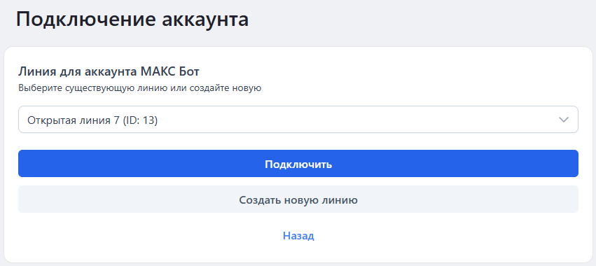
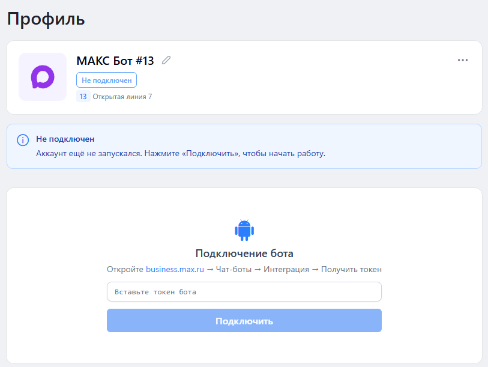

# Авторизация МАКС Бота


Для работы с МАКС Ботом необходима активная подписка.


Для работы с каналом МАКС Бот необходимо подключить аккаунт бота в приложении Олчат ОМНИ.

Авторизация выполняется самостоятельно через интерфейс приложения.

### Условия подключения

Перед началом убедитесь, что у вас есть:

* Установленное приложение Олчат ОМНИ в Битрикс24.
* Созданный бот в мессенджере МАКС.
* Активная подписка для работы с МАКС Ботом.

### Порядок авторизации

1.  Откройте приложение Олчат ОМНИ. 

    <figure><figcaption></figcaption></figure>
2.  В разделе **Подключить интеграцию** выберите **МАКС Бот**.

    <figure><figcaption></figcaption></figure>
3.  Подключите аккаунт. 

    <figure><figcaption></figcaption></figure>
4.  Настройте подключение. 

    <figure><figcaption></figcaption></figure>

После успешной авторизации МАКС Бот становится доступен для работы в Олчат ОМНИ. Подключённую линию можно использовать при настройке роботов МАКС Бота в бизнес-процессах CRM.
