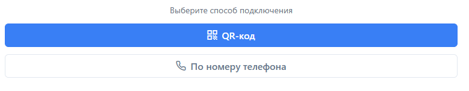

# Авторизация WhatsApp

Для работы коннектора WhatsApp в приложении Олчат ОМНИ необходимо выполнить авторизацию аккаунта. Подключение доступно через QR-код или по номеру телефона с помощью кода привязки.

### Порядок авторизации

**Требования**

* Установленное приложение Олчат ОМНИ.
* Права на подключение коннектора и настройку Открытой линии в Битрикс24.
* Доступ к WhatsApp на телефоне с аккаунтом, который необходимо подключить.

Подробнее о правах доступа — в статье [«Настройка прав»](https://docs.olchat.ru/omni/bystryi-start/nastroika-prav).

#### Шаг 1. Добавление коннектора

1. Откройте приложение Олчат ОМНИ на портале Битрикс24.
2.  В меню слева выберите интеграцию **WhatsApp**. Также можно нажать **Подключить** вверху справа. 

    <figure><figcaption></figcaption></figure>
3. Выберите Открытую линию и нажмите **Подключить**.
4.  На экране авторизации выберите способ подключения: **QR-код** или **По номеру телефона**. 

    <figure><figcaption></figcaption></figure>

#### Шаг 2. Авторизация&#x20;

**Через QR-код**

1. На странице авторизации выберите **QR-код** и дождитесь его появления.
2. Откройте WhatsApp на телефоне.
3. Перейдите в раздел **Связанные устройства**:
   *   На Android откройте меню **⋮ → Связанные устройства**. 

       <figure><figcaption></figcaption></figure>
   * На iPhone откройте **Настройки → Связанные устройства**.
4.  Нажмите кнопку привязки устройства. 

    <figure><figcaption></figcaption></figure>
5. Отсканируйте QR-код, отображаемый в Олчат ОМНИ.
6. Дождитесь завершения подключения.

QR-код в Олчат ОМНИ обновляется автоматически.

**По номеру телефона**

Если нет возможности отсканировать QR-код, можно подключить аккаунт WhatsApp с помощью кода привязки.

1. На странице авторизации выберите **По номеру телефона**.
2. Введите номер телефона аккаунта WhatsApp в международном формате.
3. Нажмите **Получить код**.
4. Дождитесь появления кода привязки в Олчат ОМНИ.
5.  Откройте WhatsApp на телефоне и перейдите в раздел **Связанные устройства**. 

    <figure><figcaption></figcaption></figure>
6. Нажмите кнопку привязки устройства и выберите **Связать по номеру телефона**.
7. Введите в WhatsApp код, отображаемый в Олчат ОМНИ.
8. Дождитесь завершения подключения.

Код привязки отображается в Олчат ОМНИ. Его необходимо ввести в WhatsApp на телефоне. Ожидать СМС не требуется.

Если код не подходит или необходимо запросить другой, нажмите **Получить новый код** и используйте новый код для привязки.

#### Шаг 2.2. Авторизация через QR-код другим сотрудником

Если подключением занимается один сотрудник, а телефон с нужным аккаунтом WhatsApp находится у другого, можно передать ссылку на QR-код.

Для этого:

1. Откройте экран авторизации WhatsApp через **QR-код**.
2.  Нажмите **Поделиться ссылкой на QR-код**. 

    <figure><figcaption></figcaption></figure>
3. Отправьте скопированную ссылку сотруднику, у которого находится телефон с нужным аккаунтом WhatsApp.
4. Сотрудник должен открыть ссылку на другом экране, перейти в WhatsApp в раздел **Связанные устройства** и отсканировать QR-код.

Передавайте ссылку только сотруднику, которому доверено подключение аккаунта WhatsApp.

#### Шаг 3. Настройка коннектора

Подробнее о настройке коннектора — в статье [«Подключение коннектора»](https://docs.olchat.ru/omni/bystryi-start/podklyuchenie-konnektora).

#### Шаг 4. Проверка подключения

1. Убедитесь, что в Олчат ОМНИ отображается подключённый аккаунт WhatsApp.
2. Отправьте тестовое сообщение с другого аккаунта WhatsApp на подключённый номер.
3. Проверьте, что сообщение поступило в выбранную Открытую линию Битрикс24.
4. Ответьте на сообщение из Битрикс24 и убедитесь, что ответ получен в WhatsApp.

Для проверки поступления сообщений сотрудник должен иметь доступ к выбранной Открытой линии.

### Возможные проблемы и решения

* **QR-код не сканируется** — откройте сканер через раздел **Связанные устройства** в WhatsApp. Убедитесь, что QR-код полностью помещается в рамку сканера.
* **QR-код не отображается** — дождитесь окончания подготовки подключения. Если доступна кнопка **Загрузить QR-код**, нажмите её.
* **Код привязки не подходит** — проверьте указанный номер телефона. Нажмите **Получить новый код** и введите новый код в WhatsApp.
* **Сообщения не приходят** — проверьте состояние подключения, выбранную Открытую линию и права доступа сотрудника. Если проблема сохраняется, обратитесь в поддержку Олчат.

### Важные замечания

* Для авторизации по номеру телефона используется код привязки, который отображается в Олчат ОМНИ, а не код из СМС.
* Если телефон с нужным аккаунтом WhatsApp находится у другого сотрудника, ему можно передать ссылку на QR-код для подключения.
