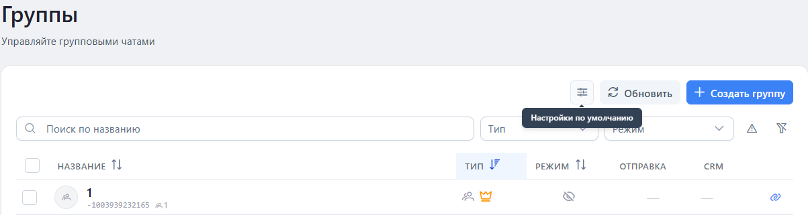
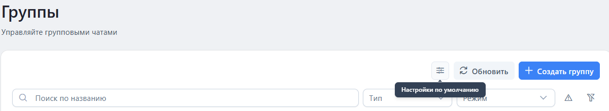

# Групповые чаты

Олчат ОМНИ — это единый интерфейс для работы с МАКС, Telegram и WhatsApp в рамках интеграции с Битрикс24. Здесь вы можете быстро создавать и подключать группы, настраивать их поведение и управлять общением в одном месте.

### Список групп

Чтобы открыть список групп:

1. В левом меню портала Битрикс24 перейдите в приложение **Олчат ОМНИ**.
2. Выберите нужный коннектор: МАКС, Telegram или WhatsApp.
3. В меню слева выберите **Список групп**.

<figure><figcaption></figcaption></figure>

В этом разделе отображаются подключённые группы выбранного коннектора. Здесь доступны поиск, фильтры и инструменты управления.

<figure><figcaption></figcaption></figure>

#### Список

Содержит название, тип и режим группы. В колонке **CRM** отображается привязанный элемент CRM.

#### Фильтры

Можно воспользоваться следующими фильтрами:

* по типу групп:
  * Telegram: группы, супергруппы, каналы, форумы, боты и DM-каналы.
  * МАКС: группы, каналы и боты.
  * WhatsApp: группы.
* по режиму работы;
* по наличию проблем с доставкой.

#### Режим работы групп

В списке можно выбрать несколько групп в пределах одной линии и установить для них режим работы.

<figure><figcaption></figcaption></figure>

#### Кнопки и действия

* [**Настройки по умолчанию**](gruppovye-chaty.md#nastroiki-po-umolchaniyu)**.**
* **Обновить** — синхронизировать список групп.
* **Создать группу** — создать новую группу.
* **Сбросить фильтры** — убрать установленные фильтры.
* Фильтр групп с проблемами доставки — показать группы, для которых обнаружены проблемы с доставкой.

#### Привязка группы к CRM

<figure><figcaption></figcaption></figure>

Группу можно привязать к одной из следующих сущностей CRM:

* Лид.
* Сделка.
* Контакт.
* Компания.

### Настройки по умолчанию

<figure><figcaption></figcaption></figure>

Эти настройки будут автоматически применяться ко всем новым группам коннектора — как к тем, которые вы создадите сами, так и к тем, в которые вас или ваших сотрудников добавят клиенты.

Если вы не установили настройки по умолчанию до подключения, то группы можно подключить и настроить вручную. Однако обязательно зайдите в **Настройки по умолчанию** и задайте нужные параметры — они будут применяться ко всем новым группам в дальнейшем.


Если настройки по умолчанию уже установлены до подключения номера, то после подключения все существующие группы на номере автоматически подтянутся в Список групп. Чаты в Открытых линиях появятся только после того, как в группу кто-то напишет.


<figure><figcaption></figcaption></figure>

**Скрывать имена сотрудников**

Переключатель **Скрывать имена сотрудников** включает или отключает скрытие имён сотрудников.

**Режим подключения по умолчанию**

Для Telegram доступны настройки режимов подключения для групп, каналов, форумов, ботов и DM-каналов.

Для МАКС доступны настройки режимов подключения групп, каналов и. ботов

Для WhatsApp доступна настройка режима подключения для групп.

Для каждого типа можно выбрать один из трёх режимов:

* **Создавать чаты ОЛ**.
* **Создавать групповые чаты**.
* **Не создавать чат**.

**Администраторы групп по умолчанию**

В поле **Администраторы групп по умолчанию** можно добавить сотрудников, которые будут назначаться администраторами новых групп, если при создании группы администратор не выбран.

### Подробные настройки

Чтобы открыть настройки конкретной группы, нажмите на её название в [Списке групп](gruppovye-chaty.md#spisok-grupp).

В подробных настройках доступны следующие возможности:

* Изменение режима работы группы.
* Привязка группы к CRM (возможность связать с лидом, сделкой, контактом или компанией).
* Управление группой (возможность покинуть группу или удалить её).

<figure><figcaption></figcaption></figure>

Для супергрупп также предусмотрены добавление и разблокировка участников, просмотр их ролей.

<figure><figcaption></figcaption></figure>

### Как создать групповой чат

Создать новую группу можно непосредственно из приложения.

1.  В разделе **Список групп** нажмите **Создать группу**. 

    <figure><figcaption></figcaption></figure>
2. Укажите **Название** группы.
3. При необходимости заполните описание.
4.  Нажмите **Создать**. 

    <figure><figcaption></figcaption></figure>
