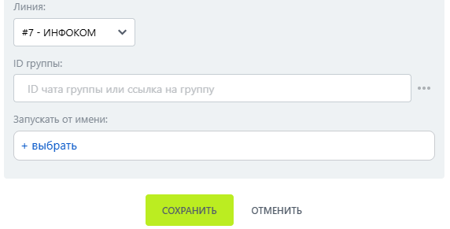

# Индикатор печати

Индикатор печати — робот, который показывает в группе МАКС, что бот печатает сообщение.

### Настройка робота

1. Добавьте робота.

Откройте конструктор бизнес-процессов CRM Битрикс24 и добавьте \[МАКС Бот] Индикатор печати.

2. Заполните параметры.

В поле Линия выберите подключённую линию МАКС Бота:

* Линия — подключённая линия МАКС Бота.
*   ID группы. 

    <figure><figcaption></figcaption></figure>

3. Запустите бизнес-процесс.

Сохраните настройки и запустите бизнес-процесс на нужной сущности CRM.&#x20;

### Результат

В группе на несколько секунд появляется индикатор печати бота.
