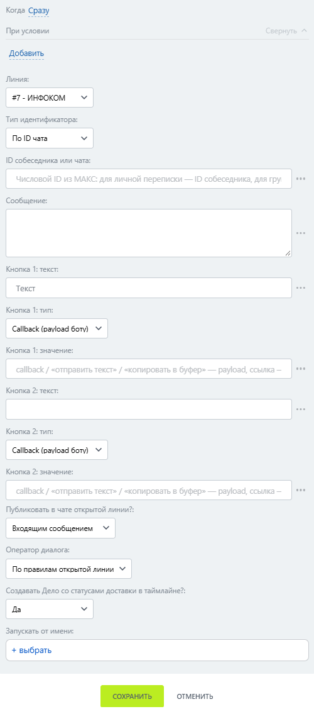

# Интерактивное меню

Интерактивное меню — робот, который отправляет сообщение с интерактивными кнопками.


Первая кнопка обязательна.&#x20;


### Настройка

1. Добавьте робота.

Откройте конструктор бизнес-процессов CRM Битрикс24 и добавьте \[МАКС Бот] Интерактивное меню.

2. Заполните параметры.

Заполните поля:

* Линия — подключённая линия МАКС Бота.
* Тип индентификатора.
* ID собеседника или чата.
* Сообщение — текст сообщения.
* Кнопка N: текст — надпись на кнопке.
* Кнопка N: тип — действие кнопки.
* Кнопка N: значение — значение действия, например ссылка или callback-значение.

<figure><figcaption></figcaption></figure>

3. Запустите бизнес-процесс.

Сохраните настройки и запустите бизнес-процесс на нужной сущности CRM.

### Результат

Кнопки отображаются в МАКС отдельными строками. Значение при нажатии появляется в Открытой линии как сообщение.&#x20;
