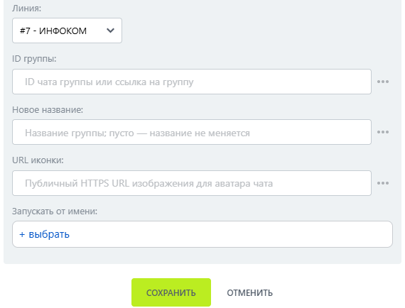

# Изменить группу

Изменить группу — робот, который изменяет название или иконку группы МАКС.

### Настройка

1. Добавьте робота.

Откройте конструктор бизнес-процессов CRM Битрикс24 и добавьте \[МАКС Бот] Изменить группу.

2. Заполните параметры.

Заполните поля:

* Линия — подключённая линия МАКС Бота.
*   ID группы. 

    <figure><figcaption></figcaption></figure>

3. Запустите бизнес-процесс.

Сохраните настройки и запустите бизнес-процесс на нужной сущности CRM.

### Результат

Название или иконка группы изменяются.&#x20;


При пустых полях изменения робот возвращает отказ: изменять нечего.

