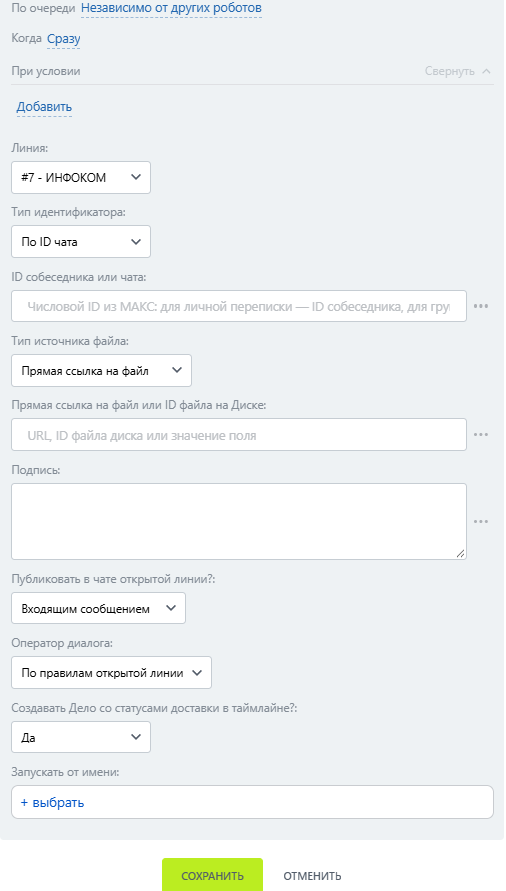

# Отправить файл

Отправить файл — робот, который отправляет файл пользователю МАКС из одного из поддерживаемых источников.

### Настройка

1. Добавьте робота.

Откройте конструктор бизнес-процессов CRM Битрикс24 и добавьте \[МАКС Бот] Отправить файл.

2. Заполните параметры.

Заполните поля:

* Линия — подключённая линия МАКС Бота.
* ID собеседника или чата — ID чата получателя.
* Тип источника файла — прямая ссылка, файл Битрикс24.Диска по ID или файл из поля CRM.
* Прямая ссылка на файл или ID файла на Диске — ссылка либо идентификатор файла в зависимости от выбранного источника.

<figure><figcaption></figcaption></figure>

3. Запустите бизнес-процесс.

Сохраните настройки и запустите бизнес-процесс на нужной сущности CRM.

### Результат

Получатель может открыть файл в МАКС; подпись отображается вместе с ним.
