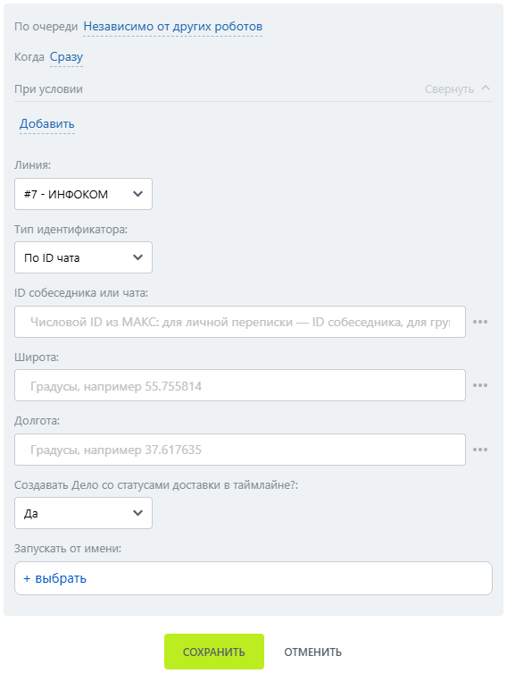

# Отправить геолокацию

Отправить геолокацию — робот, который отправляет пользователю геолокацию по координатам.

### Настройка

1. Добавьте робота.

Откройте конструктор бизнес-процессов CRM Битрикс24 и добавьте \[МАКС Бот] Отправить геолокацию.

2. Заполните параметры.

Заполните поля:

* Линия — подключённая линия МАКС Бота.
* Тип идентификатора.
* ID собеседника или чата.
* Широта — числовая широта точки.
* Долгота — числовая долгота точки.

<figure><figcaption></figcaption></figure>

3. Запустите бизнес-процесс.

Сохраните настройки и запустите бизнес-процесс на нужной сущности CRM.

### Результат

В мобильном приложении МАКС пользователь получает точку на карте.


В веб-версии МАКС эта возможность не работает; это ограничение платформы.&#x20;

