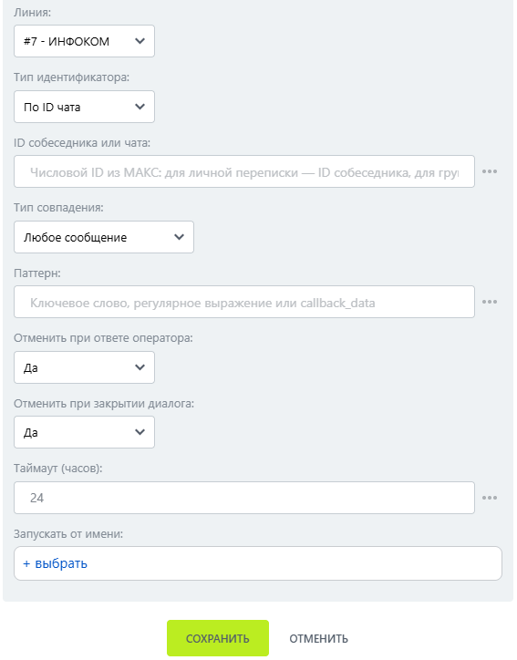

# Ожидание ответа

Ожидание ответа — робот, который ожидает сообщение пользователя по выбранному условию и продолжает бизнес-процесс.

### Настройка

1. Добавьте робота.

Откройте конструктор бизнес-процессов CRM Битрикс24 и добавьте \[МАКС Бот] Ожидание ответа.

2. Заполните параметры.

Заполните поля:

* Линия — подключённая линия МАКС Бота.
* Тип идентификатора.
*   ID собеседника или чата. 

    <figure><figcaption></figcaption></figure>

3. Запустите бизнес-процесс.

Сохраните настройки и запустите бизнес-процесс на нужной сущности CRM.

### Результат

При получении подходящего сообщения процесс продолжается. Доступны результаты Полученное сообщение, Время получения и Причина продолжения.


Ожидание может завершаться при сообщении клиента, ответе оператора, закрытии диалога или по таймауту.

