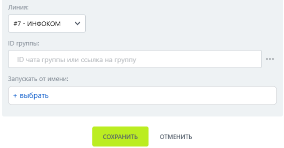

# Покинуть группу

Покинуть группу — робот, который выводит бота из группы МАКС.

### Настройка

1. Добавьте робота.

Откройте конструктор бизнес-процессов CRM Битрикс24 и добавьте \[МАКС Бот] Покинуть группу.

2. Заполните параметры.

Заполните поля:

* Линия — подключённая линия МАКС Бота.
*   ID группы. 

    <figure><figcaption></figcaption></figure>

3. Запустите бизнес-процесс.

Сохраните настройки и запустите бизнес-процесс на нужной сущности CRM.

### Результат

Бот выходит из группы; группа исчезает из списка групп линии в Олчат.


После выхода бота групповые роботы для этой группы недоступны, пока бот не будет добавлен снова.

