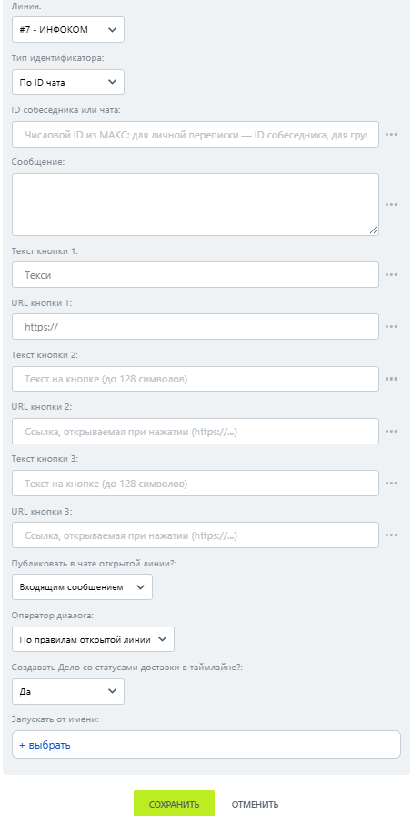

# Сообщение с кнопкой-ссылкой

Сообщение с кнопкой-ссылкой — робот, который отправляет сообщение с кнопками, открывающими ссылки.


Текст и URL первой кнопки обязательны.


### Настройка

1. Добавьте робота.

Откройте конструктор бизнес-процессов CRM Битрикс24 и добавьте \[МАКС Бот] Сообщение с кнопкой-ссылкой.

2. Заполните параметры.

Заполните поля:

* Линия — подключённая линия МАКС Бота.
* Тип индентификатора.
* ID собеседника или чата.
* Сообщение — текст сообщения.
* Текст кнопки 1 — обязательная надпись на первой кнопке.
* URL кнопки 1 — обязательный адрес первой кнопки.

<figure><figcaption></figcaption></figure>

3. Запустите бизнес-процесс.

Сохраните настройки и запустите бизнес-процесс на нужной сущности CRM.

### Результат

Кнопка открывает указанный адрес.
