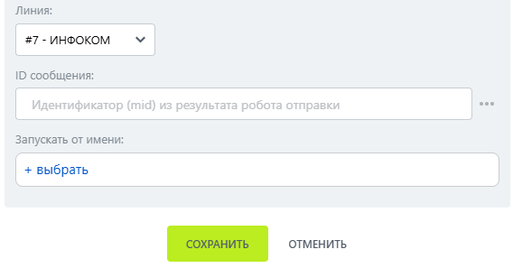

# Удалить сообщение

Удалить сообщение — робот, который удаляет ранее отправленное ботом сообщение.

### Настройка

1. Добавьте робота.

Откройте конструктор бизнес-процессов CRM Битрикс24 и добавьте \[МАКС Бот] Удалить сообщение.

2. Заполните параметры.

Заполните поля:

* Линия — подключённая линия МАКС Бота.
*   ID сообщения — идентификатор удаляемого сообщения. 

    <figure><figcaption></figcaption></figure>

3. Запустите бизнес-процесс.

Сохраните настройки и запустите бизнес-процесс на нужной сущности CRM.

### Результат

Сообщение исчезает в МАКС; в Открытой линии появляется отметка об удалении.&#x20;
