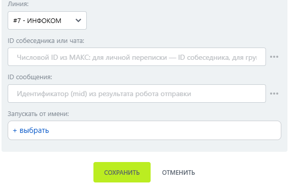

# Закрепить сообщение

Закрепить сообщение — робот, который закрепляет сообщение в группе МАКС.

### Настройка

1. Добавьте робота.

Откройте конструктор бизнес-процессов CRM Битрикс24 и добавьте \[МАКС Бот] Закрепить сообщение.

2. Заполните параметры.

Заполните поля:

* Линия — подключённая линия МАКС Бота.
* Тип идентификатора.
* ID собеседника или чата.
*   ID сообщения — идентификатор закрепляемого сообщения. 

    <figure><figcaption></figcaption></figure>

3. Запустите бизнес-процесс.

Сохраните настройки и запустите бизнес-процесс на нужной сущности CRM.

### Результат

Сообщение закрепляется в группе.


В личных чатах МАКС закрепление сообщений не поддерживается.

