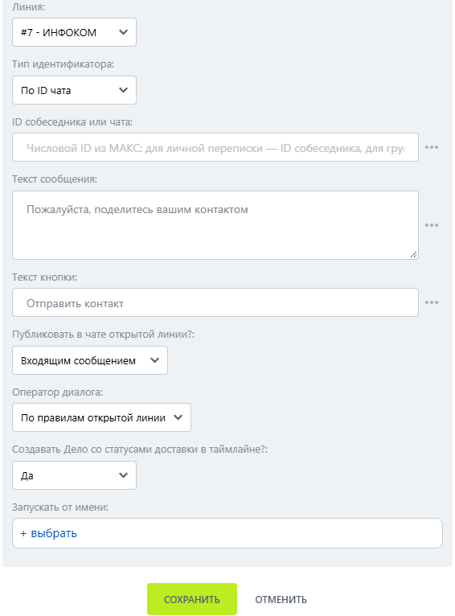

# Запросить контакт

Запросить контакт — робот, который предлагает пользователю отправить свои контактные данные.

### Настройка

1. Добавьте робота.

Откройте конструктор бизнес-процессов CRM Битрикс24 и добавьте \[МАКС Бот] Запросить контакт.

2. Заполните параметры.

Заполните поля:

* Линия — подключённая линия МАКС Бота.
* Тип идентфикатора.
* ID собеседника или чата.

<figure><figcaption></figcaption></figure>

3. Запустите бизнес-процесс.

Сохраните настройки и запустите бизнес-процесс на нужной сущности CRM.

### Результат

После нажатия пользователь отправляет контакт в диалог, то есть самостоятельно подтверждает отправку контакта.
