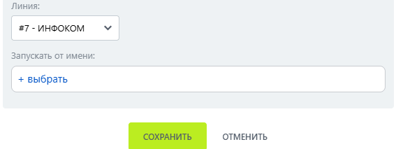
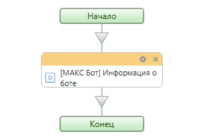
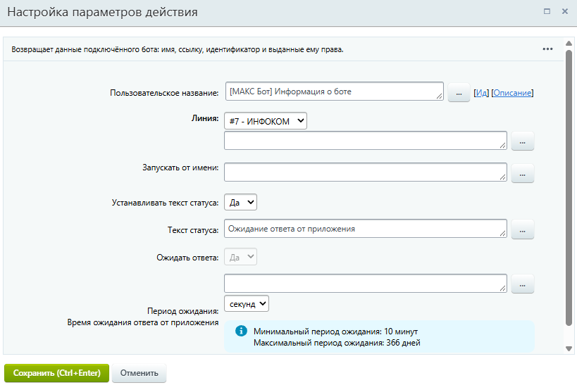

# Информация о боте

Робот **\[МАКС Бот] Информация о боте** позволяет получить сведения о подключённом боте МАКС.

### Настройка робота

1. Для получения информации о боте добавьте робота **\[МАКС Бот] Информация о боте**. \
   Для этого перейдите в раздел **Роботы → Создать → Выбор стадии → Другие роботы → \[Олчат ОМНИ] \[МАКС Бот] Информация о боте → Добавить**.
2. Заполните параметры:

* Выберите **Линию**, к которой подключён МАКС Бот.
*   Укажите, от чьего имени будет запускаться робот.  Нажмите **Сохранить**. 

    <figure><figcaption></figcaption></figure>

#### Результат

После выполнения робот возвращает следующие данные:

* **Имя бота** — имя подключённого бота.
* **Username бота** — имя пользователя бота в МАКС.
* **ID бота** — идентификатор бота.
* **Статус** — статус бота.

### Настройка активити

Активити **\[МАКС Бот] Информация о боте** позволяет получить сведения о подключённом боте в рамках выполнения бизнес-процесса.

<figure><figcaption></figcaption></figure>

Добавьте активити **\[МАКС Бот] Информация о боте** и выполните настройку параметров аналогично настройке робота:

1. Выберите **Линию**, к которой подключён МАКС Бот.
2.  Укажите, от чьего имени будет запускаться активити. 

    <figure><figcaption></figcaption></figure>
3. Сохраните настройки.

