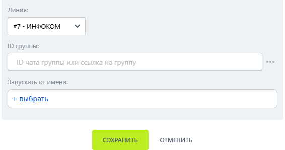

# Информация о чате

Робот **\[МАКС Бот] Информация о чате** позволяет получить сведения о чате МАКС: название, описание, количество участников, идентификатор владельца, тип чата и признак публичности.

Полученные данные можно использовать в следующих действиях бизнес-процесса Битрикс24. Например, определить, является ли чат группой или каналом, и настроить разные сценарии автоматизации.

<figure><figcaption></figcaption></figure>

### Настройка робота

Для получения информации о чате добавьте робот **\[МАКС Бот] Информация о чате** в бизнес-процесс Битрикс24.

Перейдите в раздел **Роботы → Создать → Выбор стадии → Другие роботы → \[МАКС Бот] Информация о чате → Добавить**.

После добавления нажмите **Изменить** и заполните параметры:

* **Линия** — выберите Открытую линию, к которой подключён МАКС Бот. Обязательное поле.
* **ID группы** — укажите числовой идентификатор группы или канала МАКС, включая знак минус. Обязательное поле.
* **Запускать от имени** — выберите пользователя, от имени которого будет запускаться робот. 

<figure><figcaption></figcaption></figure>

После заполнения параметров нажмите **СОХРАНИТЬ**.

### Результат работы робота

После выполнения робот возвращает сведения о выбранном чате. Они доступны в дополнительных результатах робота.

* **Название** — название чата.
* **Описание** — описание чата.
* **Число участников** — количество участников чата.
* **ID владельца** — идентификатор владельца чата.
* **Публичная** — признак публичности чата: `Y` — да, `N` — нет.
* **Тип чата** — тип чата: `dialog` — личный диалог, `chat` — группа, `channel` — канал.
* **Это канал** — признак канала: `Y` — чат является каналом, `N` — не является.
* **Текст ошибки** — описание ошибки, если получить сведения не удалось.
* **Код ошибки** — код ошибки, который можно использовать в условиях бизнес-процесса.

Если МАКС не передал название, описание или ID владельца, соответствующие результаты остаются пустыми. Если количество участников не передано, робот возвращает `0`.
