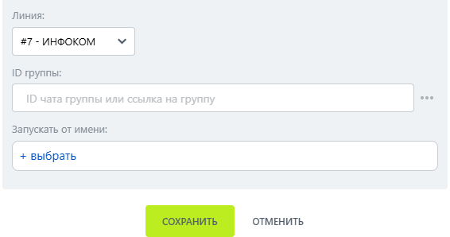

# Информация о чате

Информация о чате — робот, который получает сведения о чате МАКС.

### Настройка

1. Добавьте робота.

Откройте конструктор бизнес-процессов CRM Битрикс24 и добавьте \[МАКС Бот] Информация о чате.

2. Заполните параметры.

Заполните поля:

* Линия — подключённая линия МАКС Бота.
*   ID группы — идентификатор группы. 

    <figure><figcaption></figcaption></figure>

3. Запустите бизнес-процесс.

Сохраните настройки и запустите бизнес-процесс на нужной сущности CRM.

### Результат

Робот возвращает описание, число участников и владельца чата.

