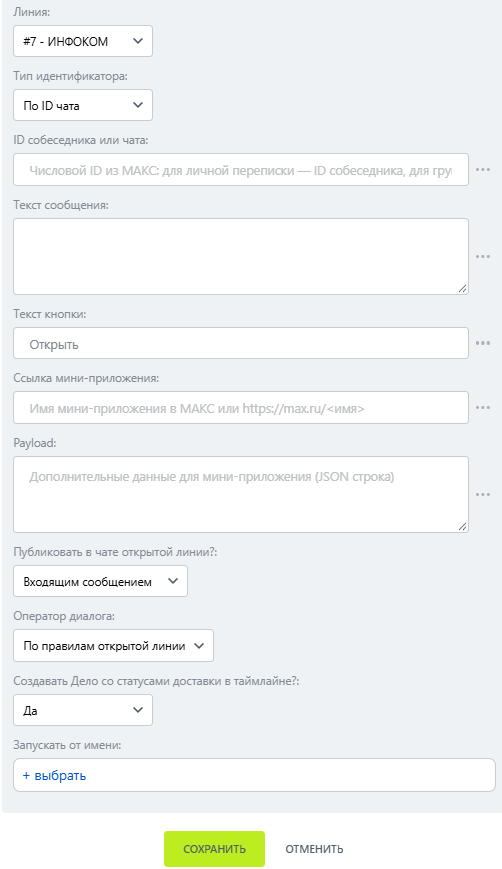

# Открыть мини-приложение

Открыть мини-приложение — робот, который отправляет сообщение с кнопкой открытия мини-приложения МАКС.

### Настройка

1. Добавьте робота.

Откройте конструктор бизнес-процессов CRM Битрикс24 и добавьте \[МАКС Бот] Открыть мини-приложение.

2. Заполните параметры.

Заполните поля:

* Линия — подключённая линия МАКС Бота.
* Тип идентификатора.
* ID собеседника или чата.
* Текст сообщения — текст для пользователя.
* Ссылка мини-приложения — имя мини-приложения или адрес вида https://max.ru/имя.

<figure><figcaption></figcaption></figure>

3. Запустите бизнес-процесс.

Сохраните настройки и запустите бизнес-процесс на нужной сущности CRM.

### Результат

После нажатия кнопки мини-приложение открывается внутри МАКС.
