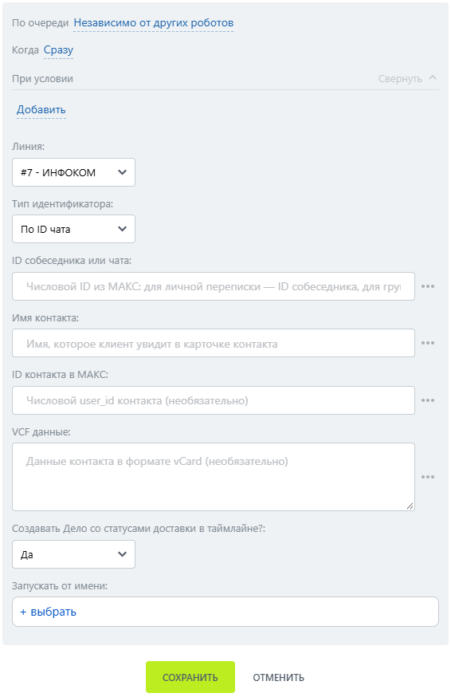

# Отправить контакт

Отправить контакт — робот, который отправляет карточку контакта в чат МАКС.

### Настройка

1. Добавьте робота.

Откройте конструктор бизнес-процессов CRM Битрикс24 и добавьте \[МАКС Бот] Отправить контакт.

2. Заполните параметры.

Заполните поля:

* Линия — подключённая линия МАКС Бота.
* ID собеседника или чата.
* Имя контакта.

<figure><figcaption></figcaption></figure>

3. Запустите бизнес-процесс.

Сохраните настройки и запустите бизнес-процесс на нужной сущности CRM.

### Результат

Клиент получает карточку контакта.

ID контакта в МАКС — числовой идентификатор пользователя, не номер телефона.&#x20;
