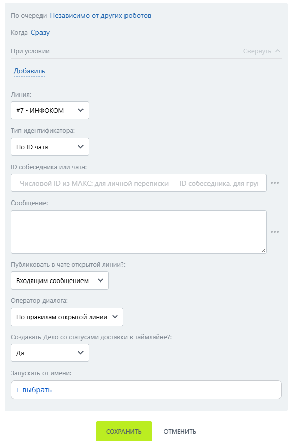

# Отправить сообщение

Отправить сообщение — робот, который отправляет текстовое сообщение пользователю МАКС.

### Настройка робота

1. Добавьте робота.

Откройте конструктор бизнес-процессов CRM Битрикс24 и добавьте \[МАКС Бот] Отправить сообщение.

2. Заполните параметры.

Выберите подключённую линию МАКС Бота и заполните поля:

* Линия — подключённая линия МАКС Бота.
* ID собеседника или чата — укажите числовой ID чата для группы или ID собеседника.&#x20;
* Сообщение — текст отправляемого сообщения.&#x20;

<figure><figcaption></figcaption></figure>

3. Запустите бизнес-процесс.

Сохраните настройки и запустите бизнес-процесс на нужной сущности CRM.

### Результат

Сообщение поступает пользователю. В дополнительных результатах доступны Отправлено и ID сообщения.
