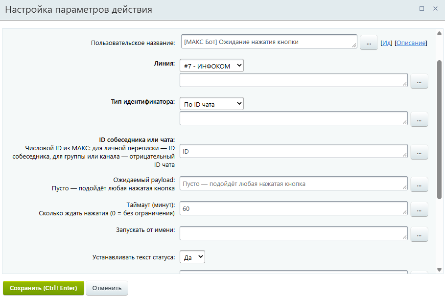

# Ожидание нажатия кнопки

Робот **\[МАКС Бот] Ожидание нажатия кнопки** приостанавливает выполнение бизнес-процесса до нажатия пользователем интерактивной кнопки в сообщении МАКС Бота.


Повторное нажатие по ранее отправленному меню также обрабатывается.


### Настройка робота

Для ожидания нажатия интерактивной кнопки добавьте робот **\[МАКС Бот] Ожидание нажатия кнопки** в бизнес-процесс CRM Битрикс24.

1.  **Добавьте робота.**

    Перейдите в раздел **Роботы → Создать → Выбор стадии → Другие роботы → \[Олчат ОМНИ] \[МАКС Бот] Ожидание нажатия кнопки → Добавить**.
2.  **Заполните параметры.**

    Нажмите **Изменить** и заполните поля:

    * **Линия** — выберите Открытую линию с подключённым МАКС Ботом, в которой ожидается нажатие кнопки. Обязательное поле.
    * **Тип идентификатора** — выберите **По ID чата**. Для МАКС Бота доступен только этот вариант.
    * **ID собеседника или чата** — укажите числовой идентификатор собеседника или чата МАКС. Для личной переписки используется ID собеседника, для группы или канала — отрицательный ID чата. Обязательное поле.

    <figure><figcaption></figcaption></figure>
3.  **Сохраните настройки.**

    Нажмите **СОХРАНИТЬ**.

#### Результат работы

Робот продолжает выполнение бизнес-процесса после подходящего нажатия кнопки, истечения времени ожидания, ответа оператора или закрытия диалога.

В дополнительных результатах предусмотрены следующие значения:

* **Кнопка нажата** — показывает, завершилось ли ожидание нажатием кнопки.
* **Payload нажатой кнопки** — значение, переданное кнопкой при нажатии.
* **ID нажатия (для робота «Подтвердить нажатие кнопки»)** — идентификатор, необходимый для подтверждения нажатия.
* **Полученное сообщение** — при нажатии кнопки содержит её payload.
* **Время получения** — время получения ответа.
* **Таймаут** — `Y`, если время ожидания истекло; `N`, если ожидание завершилось по другой причине.
* **Причина пробуждения** — событие, после которого бизнес-процесс продолжил выполнение.
* **Текст ошибки** — описание ошибки при выполнении робота.
* **Код ошибки** — код ошибки, который можно использовать в условиях бизнес-процесса.


Ожидание может завершиться без нажатия кнопки. Перед обработкой payload или подтверждением нажатия проверяйте результат **Кнопка нажата**.


### Настройка активити (действия) бизнес-процесса

Активити **\[МАКС Бот] Ожидание нажатия кнопки** предназначено для ожидания нажатия интерактивной кнопки в рамках выполнения бизнес-процесса.

Добавьте действие **\[МАКС Бот] Ожидание нажатия кнопки** в конструкторе бизнес-процессов.

Заполните параметры аналогично настройке робота:

<figure><figcaption></figcaption></figure>

