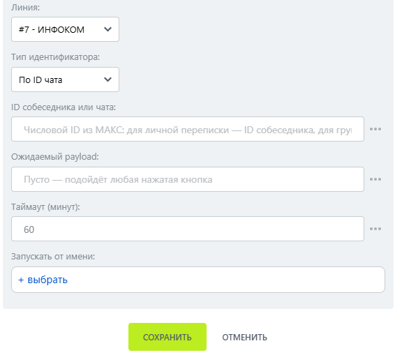

# Ожидание нажатия кнопки

Ожидание нажатия кнопки — робот, который ожидает нажатия интерактивной кнопки и продолжает бизнес-процесс.

### Настройка

1. Добавьте робота.

Откройте конструктор бизнес-процессов CRM Битрикс24 и добавьте \[МАКС Бот] Ожидание нажатия кнопки.

2. Заполните параметры.

Заполните поля:

* Линия — подключённая линия МАКС Бота.
* Тип идентификатора.
* ID собеседника или чата.

<figure><figcaption></figcaption></figure>

3. Запустите бизнес-процесс.

Сохраните настройки и запустите бизнес-процесс на нужной сущности CRM.

### Результат

После нажатия доступны Кнопка нажата и данные кнопки.&#x20;


Повторное нажатие по ранее отправленному меню также обрабатывается.&#x20;

