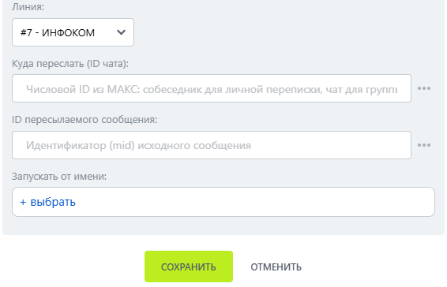

# Переслать сообщение

Переслать сообщение — робот, который пересылает сообщение в другой чат или группу МАКС.

### Настройка

1. Добавьте робота.

Откройте конструктор бизнес-процессов CRM Битрикс24 и добавьте \[МАКС Бот] Переслать сообщение.

2. Заполните параметры.

Заполните поля:

* Линия — подключённая линия МАКС Бота.
* Куда переслать (ID чата) — идентификатор чата получателя.
*   ID пересылаемого сообщения — идентификатор исходного сообщения. 

    <figure><figcaption></figcaption></figure>

3. Запустите бизнес-процесс.

Сохраните настройки и запустите бизнес-процесс на нужной сущности CRM.

### Результат

Сообщение появляется в целевом чате с пометкой пересылки.&#x20;
