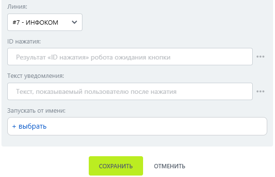
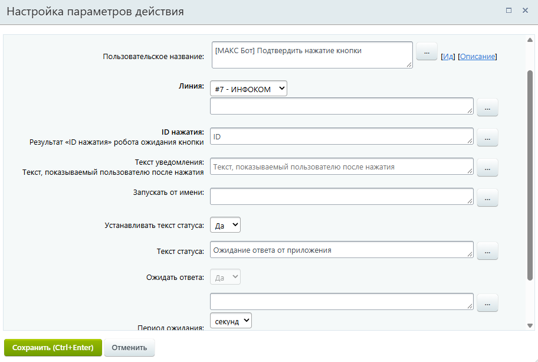

# Подтвердить нажатие кнопки

Робот **\[МАКС Бот] Подтвердить нажатие кнопки** подтверждает нажатие интерактивной кнопки в сообщении МАКС Бота. После выполнения у пользователя исчезает индикатор ожидания на кнопке. При необходимости робот показывает всплывающее уведомление.

### Настройка робота

1. Добавьте робота.

Перейдите в раздел **Роботы → Создать → Выбор стадии → Другие роботы → \[МАКС Бот] Подтвердить нажатие кнопки → Добавить**.

2. Заполните параметры.

Заполните поля:

* Линия — подключённая линия МАКС Бота.
* ID нажатия.

<figure><figcaption></figcaption></figure>

3. Запустите бизнес-процесс.

Сохраните настройки и запустите бизнес-процесс на нужной сущности CRM.

#### Результат работы робота

После выполнения робот подтверждает обработку нажатия интерактивной кнопки.

В дополнительных результатах доступны:

* **Успешно** — результат выполнения подтверждения.
* **Текст ошибки** — описание ошибки, если подтвердить нажатие не удалось.
* **Код ошибки** — код ошибки для проверки результата в условиях бизнес-процесса.

После успешного подтверждения у пользователя исчезает индикатор ожидания на кнопке. Если заполнено поле **Текст уведомления**, в мобильном приложении МАКС отображается всплывающее уведомление. Его отображение в веб-версии зависит от платформы МАКС.


**О**жидание нажатия может завершиться по таймауту, при ответе оператора или закрытии диалога.&#x20;


### Настройка активити (действия) бизнес-процесса

Активити **\[МАКС Бот] Подтвердить нажатие кнопки** предназначено для подтверждения нажатия интерактивной кнопки в рамках бизнес-процесса.

Добавьте действие **\[МАКС Бот] Подтвердить нажатие кнопки** в конструкторе бизнес-процессов.

Для выполнения подтверждения необходимо передать подключённую линию МАКС Бота и ID нажатия, полученный предыдущим действием ожидания.

<figure><figcaption></figcaption></figure>
