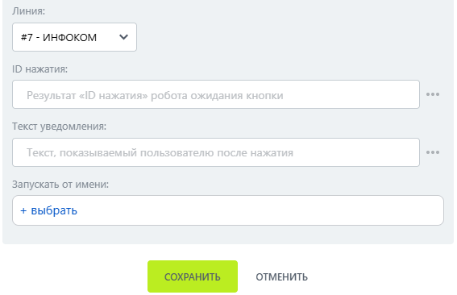

# Подтвердить нажатие кнопки

Подтвердить нажатие кнопки — робот, который подтверждает обработку нажатия интерактивной кнопки.


Используйте действие после получения нажатия интерактивной кнопки.


### Настройка

1. Добавьте робота.

Откройте конструктор бизнес-процессов CRM Битрикс24 и добавьте \[МАКС Бот] Подтвердить нажатие кнопки.

2. Заполните параметры.

Заполните поля:

* Линия — подключённая линия МАКС Бота.
* ID нажатия.

<figure><figcaption></figcaption></figure>

3. Запустите бизнес-процесс.

Сохраните настройки и запустите бизнес-процесс на нужной сущности CRM.

### Результат

В мобильном приложении МАКС отображается уведомление. Новое сообщение в чате при этом не создаётся.
