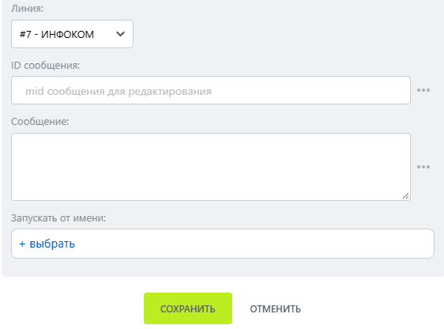

# Редактировать сообщение

Редактировать сообщение — робот, который изменяет текст ранее отправленного ботом сообщения.

Получите ID сообщения, передайте его в робот и укажите новый текст.

### Настройка

1. Добавьте робота.

Откройте конструктор бизнес-процессов CRM Битрикс24 и добавьте \[МАКС Бот] Редактировать сообщение.

2. Заполните параметры.

Заполните поля:

* Линия — подключённая линия МАКС Бота.
* ID сообщения.
*   Сообщение — новый текст. 

    <figure><figcaption></figcaption></figure>

3. Запустите бизнес-процесс.

Сохраните настройки и запустите бизнес-процесс на нужной сущности CRM.

### Результат

Текст ранее отправленного сообщения изменяется в МАКС, новое сообщение не создаётся. В Открытой линии появляется отметка об изменении.
