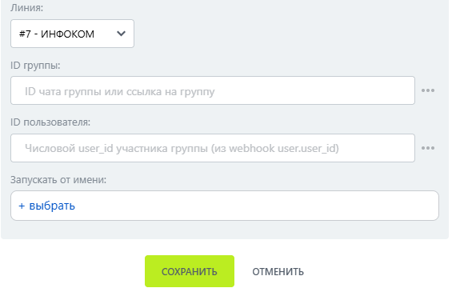

# Снять администратора

Снять администратора — робот, который снимает права администратора с участника группы МАКС.

### Настройка

1. Добавьте робота.

Откройте конструктор бизнес-процессов CRM Битрикс24 и добавьте \[МАКС Бот] Снять администратора.

2. Заполните параметры.

Заполните поля:

* Линия — подключённая линия МАКС Бота.
* ID группы.
*   ID пользователя. 

    <figure><figcaption></figcaption></figure>

3. Запустите бизнес-процесс.

Сохраните настройки и запустите бизнес-процесс на нужной сущности CRM.

### Результат

Права администратора снимаются с указанного участника.&#x20;
