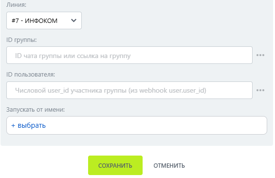

# Снять администратора

Робот **\[МАКС Бот] Снять администратора** предназначен для снятия прав администратора с участника группы МАКС.

Для выполнения действия необходимо указать группу и идентификатор пользователя, чьи права требуется изменить.


Снять права администратора с владельца группы нельзя.


### Настройка робота

Для снятия прав администратора добавьте робот **\[МАКС Бот] Снять администратора** в бизнес-процесс CRM Битрикс24.

\{% stepper %\}\
\{% step %\}

#### Добавьте робота

Перейдите в раздел **Роботы → Создать → Выбор стадии → Другие роботы → \[МАКС Бот] Снять администратора → Добавить**.\
\{% endstep %\}

\{% step %\}

#### Заполните параметры

На добавленном роботе нажмите **Изменить** и заполните поля:

* **Линия** — выберите Открытую линию, к которой подключён МАКС Бот. Обязательное поле.
* **ID группы** — укажите числовой идентификатор группы МАКС, включая знак минус. Обязательное поле.
* **ID пользователя** — укажите числовой идентификатор участника, с которого необходимо снять права администратора. Обязательное поле.

Для определения ID пользователя используйте результат **Участники** робота **\[МАКС Бот] Список участников группы**.

\{% hint style="info" %\}\
В поле **ID группы** используйте числовой идентификатор. Поддержка ссылок на группы в действующей версии робота не подтверждена.\
\{% endhint %\}

\[Скриншот настроек робота «Снять администратора»]\
\{% endstep %\}

\{% step %\}

#### Сохраните настройки

Нажмите **СОХРАНИТЬ**.\
\{% endstep %\}\
\{% endstepper %\}

### Настройка активити (действия) бизнес-процесса

Активити **\[МАКС Бот] Снять администратора** предназначено для отправки запроса на снятие прав администратора в рамках бизнес-процесса.

Добавьте действие **\[МАКС Бот] Снять администратора** в конструкторе бизнес-процессов.

Для выполнения действия необходимо указать:

* **Линия** — Открытая линия с подключённым МАКС Ботом.
* **ID группы** — числовой идентификатор группы МАКС.
* **ID пользователя** — идентификатор участника, с которого необходимо снять права администратора.

\[Скриншот настроек активити «Снять администратора»]

Остальные параметры настройки активити необходимо сверить с действующим интерфейсом.

### Результат работы

После выполнения робот отправляет в МАКС запрос на снятие прав администратора с указанного участника группы.

В дополнительных результатах предусмотрены следующие значения:

* **Успешно** — `Y`, если МАКС подтвердил выполнение запроса; `N`, если получена ошибка.
* **Текст ошибки** — описание ошибки при выполнении действия.
* **Код ошибки** — код ошибки, который можно использовать в условиях бизнес-процесса.

\{% hint style="warning" %\}\
Значение **Успешно: Y** не гарантирует фактического изменения прав участника. После выполнения проверьте, что пользователь больше не является администратором группы.\
\{% endhint %\}

#### Пример использования

Допустим, необходимо снять права администратора с участника группы МАКС.

1. Добавьте робот **\[МАКС Бот] Список участников группы** и получите список участников.
2. Определите идентификатор нужного администратора из результата **Участники**.
3. Добавьте робот **\[МАКС Бот] Снять администратора**.
4. Укажите линию, ID группы и ID выбранного пользователя.
5. После выполнения проверьте результат **Успешно** и фактические права пользователя в группе.

Проверку необходимо выполнять на обычном администраторе, который не является владельцем группы.

\===

Снять администратора — робот, который снимает права администратора с участника группы МАКС.

### Настройка

1. Добавьте робота.

Откройте конструктор бизнес-процессов CRM Битрикс24 и добавьте \[МАКС Бот] Снять администратора.

2. Заполните параметры.

Заполните поля:

* Линия — подключённая линия МАКС Бота.
* ID группы.
*   ID пользователя. 

    <figure><figcaption></figcaption></figure>

3. Запустите бизнес-процесс.

Сохраните настройки и запустите бизнес-процесс на нужной сущности CRM.

### Результат

Права администратора снимаются с указанного участника.
