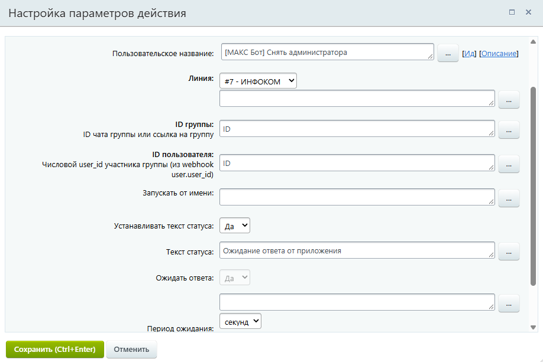

# Снять администратора

Робот **\[МАКС Бот] Снять администратора** предназначен для снятия прав администратора с участника группы МАКС.

Для выполнения действия необходимо указать группу и идентификатор пользователя, чьи права требуется изменить.


Снять права администратора с владельца группы нельзя.


### Настройка робота

Для снятия прав администратора добавьте робот **\[МАКС Бот] Снять администратора** в бизнес-процесс CRM Битрикс24.

1.  **Добавьте робота.**

    Перейдите в раздел **Роботы → Создать → Выбор стадии → Другие роботы → \[Олчат ОМНИ] \[МАКС Бот] Снять администратора → Добавить**.
2.  **Заполните параметры.**

    Нажмите **Изменить** и заполните поля:

    * **Линия** — выберите Открытую линию, к которой подключён МАКС Бот. Обязательное поле.
    * **ID группы** — укажите числовой идентификатор группы МАКС, включая знак минус. Обязательное поле.
    * **ID пользователя** — укажите числовой идентификатор участника, с которого необходимо снять права администратора. Обязательное поле.

    Для определения ID пользователя используйте результат **Участники** робота **\[МАКС Бот] Список участников группы**.

    <figure><figcaption></figcaption></figure>
3.  **Сохраните настройки.**

    Нажмите **СОХРАНИТЬ**.

#### Результат работы

После выполнения робот отправляет в МАКС запрос на снятие прав администратора с указанного участника группы.

В дополнительных результатах предусмотрены следующие значения:

* **Успешно** — `Y`, если МАКС подтвердил выполнение запроса; `N`, если получена ошибка.
* **Текст ошибки** — описание ошибки при выполнении действия.
* **Код ошибки** — код ошибки, который можно использовать в условиях бизнес-процесса.

### Настройка активити (действия) бизнес-процесса

Активити **\[МАКС Бот] Снять администратора** предназначено для отправки запроса на снятие прав администратора в рамках бизнес-процесса.

Добавьте действие **\[МАКС Бот] Снять администратора** в конструкторе бизнес-процессов.

Заполните параметры аналогично настройке робота:

* **Линия** — Открытая линия с подключённым МАКС Ботом.
* **ID группы** — числовой идентификатор группы МАКС.
* **ID пользователя** — идентификатор участника, с которого необходимо снять права администратора.

<figure><figcaption></figcaption></figure>

Остальные параметры настройки активити необходимо сверить с действующим интерфейсом.
