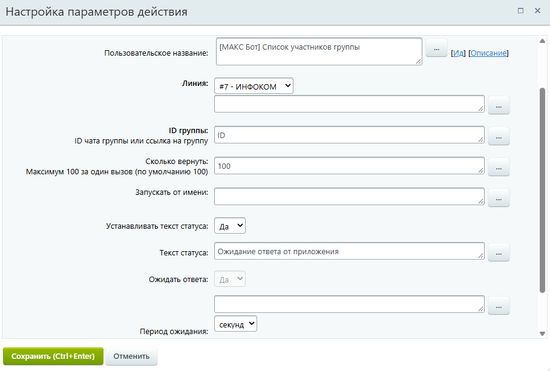

# Список участников группы

Робот **\[МАКС Бот] Список участников группы** позволяет получить имена и идентификаторы участников группы МАКС.

Полученные данные можно использовать в следующих действиях бизнес-процесса. Например, проверить наличие определённого пользователя в группе или получить его ID для управления участниками.


Для получения списка участников МАКС Бот должен быть администратором группы.


### Настройка робота

Для получения списка участников добавьте робот **\[МАКС Бот] Список участников группы** в бизнес-процесс CRM Битрикс24.

1.  **Добавьте робота.**

    Перейдите в раздел **Роботы → Создать → Выбор стадии → Другие роботы → \[МАКС Бот] Список участников группы → Добавить**.
2.  **Заполните параметры.**

    Нажмите **Изменить** и заполните поля:

    * **Линия** — выберите Открытую линию с подключённым МАКС Ботом. Обязательное поле.
    * **ID группы** — укажите числовой идентификатор группы МАКС, включая знак минус. Обязательное поле.

    <figure><figcaption></figcaption></figure>
3.  **Сохраните настройки.**

    Нажмите **СОХРАНИТЬ**.

#### Результат работы робота

После выполнения робот возвращает сведения об участниках группы МАКС.

В дополнительных результатах доступны следующие значения:

* **ID участников** — список идентификаторов полученных пользователей.
* **Участники** — список участников в формате «Имя (ID)». Если имя отсутствует, используется username пользователя в МАКС. Если нет и его, отображается «Без имени».
* **Получено** — количество участников в возвращённом списке.
* **Текст ошибки** — описание ошибки, если получить список не удалось.
* **Код ошибки** — код ошибки, который можно использовать в условиях бизнес-процесса.

Порядок элементов в результатах **ID участников** и **Участники** совпадает.

Среди полученных пользователей сначала отображается владелец группы, затем администраторы, после них — остальные участники, отсортированные по имени.

Результат **Получено** показывает количество пользователей в полученном списке, а не общее число участников группы/

### Настройка активити (действия) бизнес-процесса

Активити **\[МАКС Бот] Список участников группы** предназначено для получения сведений об участниках группы МАКС в рамках выполнения бизнес-процесса.

Для настройки добавьте активити **\[МАКС Бот] Список участников группы** в конструкторе бизнес-процессов.

Основные параметры:

* **Линия** — выберите Открытую линию с подключённым МАКС Ботом.
* **ID группы** — укажите числовой идентификатор группы МАКС.

Остальные параметры активити можно оставить без изменений, если стандартные настройки подходят для вашего бизнес-процесса.

<figure><figcaption></figcaption></figure>

Сохраните настройки активити.

Полученные результаты можно использовать в следующих действиях бизнес-процесса.
