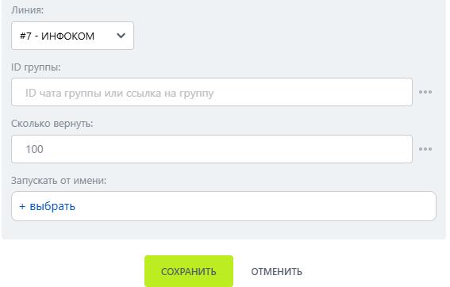

# Список участников группы

Список участников группы — робот, который получает список участников группы МАКС.

### Настройка

1. Добавьте робота.

Откройте конструктор бизнес-процессов CRM Битрикс24 и добавьте \[МАКС Бот] Список участников группы.

2. Заполните параметры.

Заполните поля:

* Линия — подключённая линия МАКС Бота.
*   ID группы — отрицательный числовой ID группы. 

    <figure><figcaption></figcaption></figure>

3. Запустите бизнес-процесс.

Сохраните настройки и запустите бизнес-процесс на нужной сущности CRM.

### Результат

Возвращает участников в формате Имя (ID); владелец и администраторы идут первыми.&#x20;
