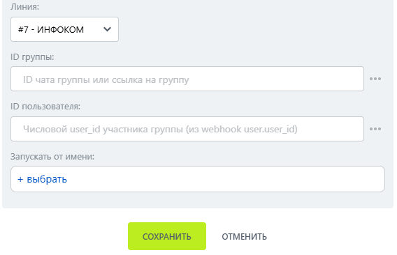

# Удалить участника

Удалить участника — робот, который исключает участника из группы МАКС.

### Настройка

1. Добавьте робота.

Откройте конструктор бизнес-процессов CRM Битрикс24 и добавьте \[МАКС Бот] Удалить участника.

2. Заполните параметры.

Заполните поля:

* Линия — подключённая линия МАКС Бота.
* ID группы.
*   ID пользователя. 

    <figure><figcaption></figcaption></figure>

3. Запустите бизнес-процесс.

Сохраните настройки и запустите бизнес-процесс на нужной сущности CRM.

### Результат

Указанный пользователь удаляется из группы.


ID следует брать из результата робота списка участников.

