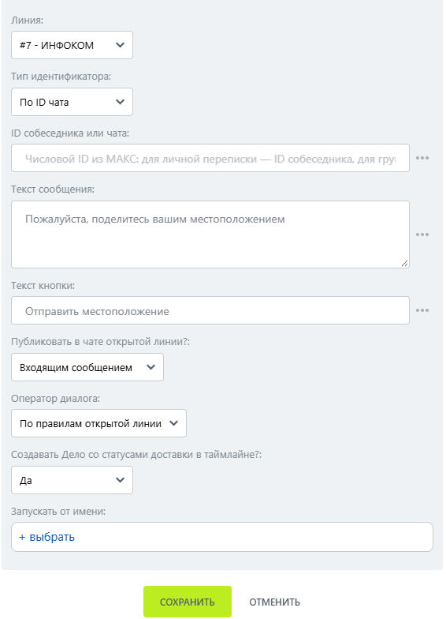

# Запросить геолокацию

Запросить геолокацию — робот, который предлагает пользователю поделиться местоположением.

### Настройка

1. Добавьте робота.

Откройте конструктор бизнес-процессов CRM Битрикс24 и добавьте \[МАКС Бот] Запросить геолокацию.

2. Заполните параметры.

Заполните поля:

* Линия — подключённая линия МАКС Бота.
* Тип индентификатора.
* ID собеседника или чата.

<figure><figcaption></figcaption></figure>

3. Запустите бизнес-процесс.

Сохраните настройки и запустите бизнес-процесс на нужной сущности CRM.

### Результат

В мобильном приложении МАКС местоположение поступает в диалог.


Функция не работает в веб-версии МАКС.

