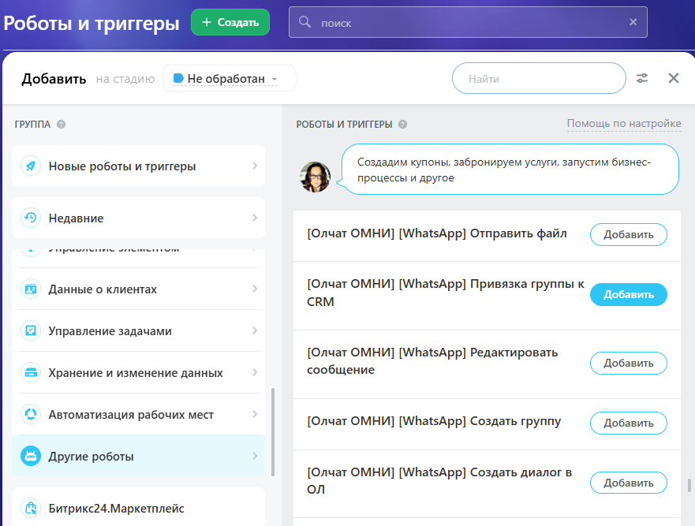
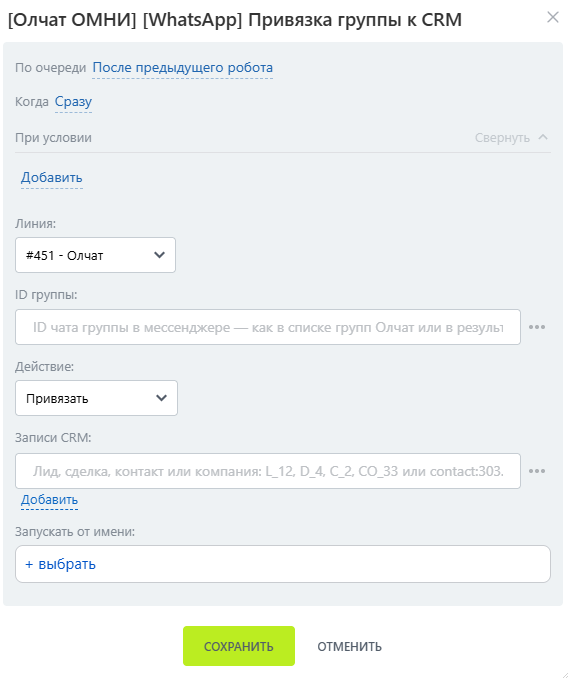
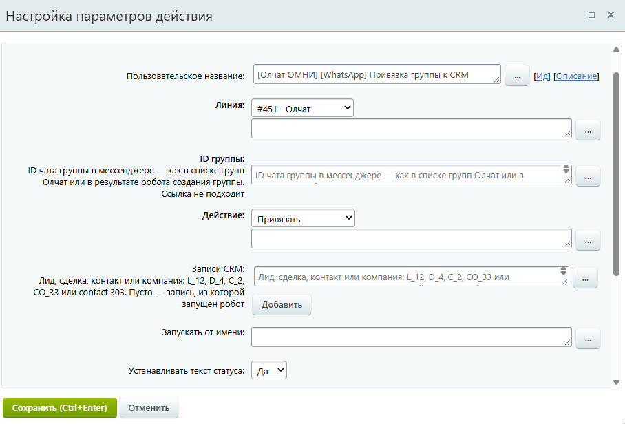

# Привязка группы к CRM

Робот **\[WhatsApp] Привязка группы к CRM** позволяет связать существующую группу WhatsApp с записями CRM Битрикс24 или снять ранее созданные связи.

Например, группу для обсуждения заказа можно привязать к сделке и контакту клиента.

Робот работает с группами, которые уже присутствуют в списке групп Олчат на выбранной линии. Создание новых групп не поддерживается.

### Настройка робота

Для настройки добавьте робот **Привязка группы к CRM** в бизнес-процесс CRM Битрикс24.

1.  **Добавьте робота.**

    Перейдите в раздел **Роботы → Создать → Выбор стадии → Другие роботы → Привязка группы к CRM → Добавить**. 

    <figure><figcaption></figcaption></figure>
2.  **Заполните параметры.**

    Нажмите **Изменить** и заполните поля:

    * **Линия** — выберите линию WhatsApp, на которой находится группа. Обязательное поле.
    *   **ID группы** — укажите ID чата группы WhatsApp из списка групп Олчат или результата робота создания группы. Можно передать полный ID с окончанием `@g.us` или его числовую часть. Ссылка-приглашение в группу не подходит. Обязательное поле. 

        <figure><figcaption></figcaption></figure>
3.  **Сохраните настройки.**

    Нажмите **Сохранить**.

#### Результат работы робота

После выполнения робот добавляет или удаляет связи группы WhatsApp с указанными записями CRM.

В дополнительных результатах доступны следующие значения:

* **Успешно** — результат выполнения действия: `Y` — выполнено, `N` — получена ошибка.
* **Привязано** — количество новых связей.
* **Отвязано** — количество снятых связей.
* **Пропущено** — количество значений в поле **Записи CRM**, которые робот не смог распознать.
* **Текст ошибки** — описание ошибки.
* **Код ошибки** — код ошибки, который можно использовать в условиях бизнес-процесса.

### Настройка активити (действия) бизнес-процесса

Активити **\[WhatsApp] Привязка группы к CRM** предназначено для добавления или удаления связей группы WhatsApp с записями CRM в рамках выполнения бизнес-процесса.

Для настройки добавьте активити в конструкторе бизнес-процессов.

<figure><figcaption></figcaption></figure>
