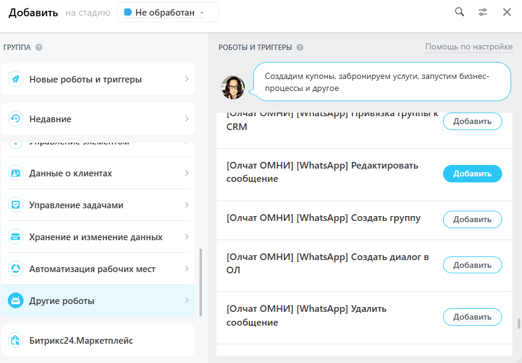
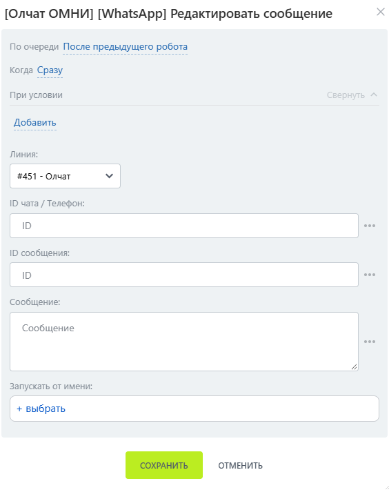

# Редактировать сообщение

Робот **\[WhatsApp] Редактировать сообщение** позволяет изменить текст ранее отправленного сообщения WhatsApp в личном или групповом чате.

### Настройка робота

Для изменения отправленного сообщения добавьте робот **Редактировать сообщение** в бизнес-процесс CRM Битрикс24.

1.  **Добавьте робота.**

    Перейдите в раздел **Роботы → Создать → Выбор стадии → Другие роботы → \[Олчат ОМНИ] \[WhatsApp] Редактировать сообщение → Добавить**. 

    <figure><figcaption></figcaption></figure>
2.  **Заполните параметры.**

    Нажмите **Изменить** и заполните поля:

    * **Линия** — выберите линию WhatsApp, с которой было отправлено исходное сообщение. Обязательное поле.
    * **ID чата / Телефон** — укажите ID чата WhatsApp или номер телефона получателя в международном формате. Для группового чата используйте ID группы WhatsApp. Обязательное поле.
    * **ID сообщения** — укажите идентификатор исходного сообщения WhatsApp. Если сообщение отправлено предыдущим роботом, можно подставить его результат **ID сообщения**. Обязательное поле.
    * **Сообщение** — введите полный новый текст, который должен заменить исходное сообщение. Обязательное поле.

    <figure><figcaption></figcaption></figure>
3.  **Сохраните настройки.**

    Нажмите **Сохранить**.

#### Результат работы робота

После выполнения робот отправляет запрос на изменение текста указанного сообщения WhatsApp.

В дополнительных результатах доступны:

* **Успешно** — результат выполнения запроса: `Y` — запрос выполнен, `N` — получена ошибка.
* **Текст ошибки** — описание ошибки.
* **Код ошибки** — код ошибки, который можно использовать в условиях бизнес-процесса.


Если время отправки исходного сообщения определить не удалось, предварительная проверка срока может быть недоступна, а WhatsApp может отклонить редактирование после принятия запроса.


#### Ограничения

* Изменить сообщение можно в течение 15 минут после отправки.
* Робот изменяет только текст. Заменить фотографии, видео и другие медиафайлы нельзя.
* При редактировании сообщения участники чата не получают новое уведомление.

### Настройка активити (действия) бизнес-процесса

Активити **\[WhatsApp] Редактировать сообщение** позволяет изменить текст ранее отправленного сообщения в рамках выполнения бизнес-процесса.

Для настройки добавьте активити **\[WhatsApp] Редактировать сообщение** в конструкторе бизнес-процессов.

Заполните обязательные параметры аналогично настройке робота:

<figure><figcaption></figcaption></figure>

Сохраните настройки активити.
