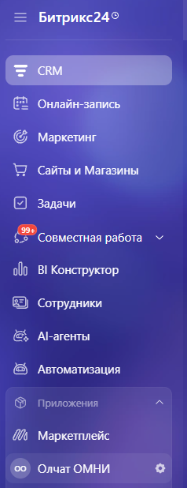
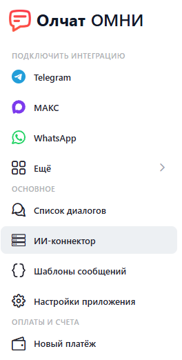

# ИИ-коннектор

**ИИ-коннектор** позволяет подключить ChatGPT, Claude и другие ИИ-сервисы к Олчат ОМНИ и работать с переписками через запросы на естественном языке.

С помощью ИИ-помощника вы можете находить клиентов, просматривать историю общения, анализировать переписки, готовить ответы и отправлять сообщения, не переключаясь между приложениями.

ИИ-коннектор работает на основе протокола MCP (Model Context Protocol), который обеспечивает взаимодействие ИИ-сервисов с инструментами Олчат ОМНИ.

### Возможности ИИ-коннектора

С помощью ИИ-коннектора можно:

* **Искать клиентов и диалоги** — находить собеседников по имени, номеру телефона или имени пользователя.
* **Читать переписку** — получать сообщения, время отправки, направление, статусы и вложения.
* **Искать сообщения** — находить нужную информацию в доступных переписках.
* **Анализировать общение** — получать краткое содержание диалога, список договорённостей, вопросы без ответа и предложения по дальнейшему общению.
* **Готовить и отправлять сообщения** — составлять ответы с помощью ИИ и отправлять их собеседникам через подключённые аккаунты.
* **Отправлять файлы** — передавать изображения и документы по прямой общедоступной ссылке.
* **Проверять подключения** — получать информацию о состоянии подключённых аккаунтов и доступности отправки сообщений.
* **Использовать голосовые запросы** — обращаться к ИИ-помощнику голосом, если подключённый ИИ-сервис поддерживает такую возможность.

Набор доступных действий зависит от мессенджера, возможностей подключения и прав пользователя.

### Как подключить ИИ-коннектор

1.  Откройте приложение Олчат ОМНИ в Битрикс24. 

    <figure><figcaption></figcaption></figure>
2.  Перейдите в раздел **ИИ-коннектор**. 

    <figure><figcaption></figcaption></figure>
3. Выберите подходящий способ подключения и следуйте инструкциям в интерфейсе приложения.

Поддерживается подключение к ChatGPT, Claude.ai, Claude Desktop, Cursor и Битрикс24 Коворк Код.

Для **ChatGPT и Claude.ai** используется адрес коннектора с авторизацией через Битрикс24. Отдельно выпускать токен не нужно.

Для **Claude Desktop и Cursor** необходимо выпустить токен доступа. Готовые команды и параметры подключения представлены в интерфейсе приложения.

### Отображение сообщений в Битрикс24

Сообщения, отправленные через ИИ-коннектор, могут публиковаться в чате Открытой линии с пометкой **ИИ**.

Для управления публикацией используется настройка **Публиковать исходящие ИИ-помощника**.

Если отключить эту настройку, сообщения продолжат отправляться собеседникам в мессенджер, но не будут отображаться в чате Открытой линии.

### Права доступа и безопасность

ИИ-коннектор работает в пределах прав сотрудника Битрикс24.

Он получает доступ только к тем подключениям и перепискам, которые доступны пользователю. Если сотрудник не имеет доступа к определённому подключению, ИИ-коннектор также не сможет с ним работать.

При подключении с помощью токена можно управлять разрешением на отправку сообщений. Выданный токен можно отозвать.

Администратор может запретить подключение ИИ-коннектора.

<figure><figcaption></figcaption></figure>
